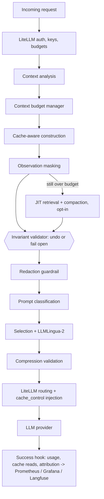

# litellm-gateway

A LiteLLM proxy that sends models less, and better-shaped, context. In one gateway it combines:

- **Context engineering** (`context_engineering/`): decides what the context should contain, and how it is laid out:
  - a token budget per request;
  - masking of old tool outputs;
  - optional just-in-time retrieval and compaction of older turns;
  - cache-aware prompt construction.
- **Prompt compression** (`prompt_compression/`):
  - shrinks what remains, safely: redaction guardrail, content-type classification, sensitivity check;
  - selects passages and log records for the question;
  - LLMLingua-2 on prose only, with ratio-cap validation.
- **Observability and evaluation** (`observability/`, `monitoring/`, `evals/`, `reports/`): OTel spans,
  Prometheus metrics with per-technique attribution, Grafana dashboards, Langfuse, live eval gates and reproducible
  benchmarks.

Everything runs as LiteLLM `async_pre_call_hook` callbacks. A client keeps using the OpenAI API unchanged, and any
request can opt out of either stage.

## Architecture

| Artifact | Path |
|---|---|
| Rendered diagram | [docs/architecture/combined_architecture.html](docs/architecture/combined_architecture.html) |
| Mermaid source | [docs/architecture/combined_architecture.mmd](docs/architecture/combined_architecture.mmd) |
| Design and reasoning | [docs/context-engineering-blueprint.md](docs/context-engineering-blueprint.md) |



Order of `litellm_settings.callbacks` in `litellm_config.yaml`: `otel`, `langfuse_otel`, `prometheus`, then
`context_engineering.callback.context_engineering_instance`, then
`observability.observed_callback.observed_prompt_compression_instance`. LiteLLM runs pre-call hooks in that order, and
the compression stage reads the context-engineering stage's hints.

## Capabilities

| Capability | Stage | Default | What it does |
|---|---|---|---|
| Context budget manager | CE | on | Window from LiteLLM's model map, output reserve, safety buffer; pressure level; oversized components; per-category tokens; calibrated against provider usage |
| Observation masking | CE | on | Byte-identical tool outputs folded; large old outputs replaced in batches by verbatim key-line stubs; recent and error outputs kept; originals recoverable by ref |
| Cache-aware construction | CE | on | Provider caching support; frozen history; Anthropic/Bedrock `cache_control` breakpoints; volatile system-prompt detection; cache read/write metrics |
| Just-in-time retrieval | CE | off | Older turns relevant to the question kept verbatim (BM25 or hybrid MiniLM); skipped on caching providers by default |
| Context compaction | CE | off | Older turns become one anchored, verbatim summary (constraints, decisions, open tasks, identifiers, small code); optional validated model-written summary in the background |
| Redaction guardrail | PC | off (`REDACT_SENSITIVE`) | Rule-matched secrets and identifiers replaced in every message and role, fails closed |
| Classification + sensitivity | PC | on | Code / structured / exact / prose blocks; rules, topics and a MiniLM head decide "keep verbatim" |
| Selection | PC | on | Passages and log/JSON records the question does not need are dropped whole (latest user message only; not for summarise/translate tasks) |
| LLMLingua-2 | PC | on | Prose only, rate 0.4, 3x ratio cap with one lighter retry, deterministic cache of outputs |
| Fail-safety | both | on | Timeouts, fail open (or closed), shadow mode, per-request opt-out, per-stage invariant checks |

## Setup

Python 3.12, CPU only. From this folder:

```bash
python -m venv .venv-compression
.venv-compression/Scripts/python -m pip install torch==2.15.0 --index-url https://download.pytorch.org/whl/cpu
.venv-compression/Scripts/python -m pip install -r prompt_compression/requirements.txt -r observability/requirements.txt
```

Context engineering needs no extra package.

**Docker** (gateway + Postgres + Redis; add `monitoring/docker-compose.monitoring.yml` for the monitoring stack):

```bash
cp .env.example .env   # set LITELLM_MASTER_KEY, LITELLM_SALT_KEY, POSTGRES_PASSWORD, REDIS_PASSWORD, LANGFUSE_* keys
docker compose -f docker-compose.quickstart.yml up -d
```

**Local, no Docker** (echo mock provider, no API key; on Windows `PYTHONUTF8=1` avoids a crash on LiteLLM's startup
banner):

```bash
.venv-compression/Scripts/python prompt_compression/dev/mock_openai_server.py --port 4010
PYTHONUTF8=1 MOCK_LLM_API_BASE=http://127.0.0.1:4010/v1 MOCK_LLM_API_KEY=mock LITELLM_MASTER_KEY=sk-local \
  .venv-compression/Scripts/litellm --config config.yaml --port 4000
```

## Configuration

All settings are environment variables, documented with their defaults in:

- [`context_engineering.env.example`](context_engineering.env.example)
- [`prompt_compression.env.example`](prompt_compression.env.example)
- [`monitoring/monitoring.env.example`](monitoring/monitoring.env.example)

The main switches:

| Variable | Default | Effect |
|---|---|---|
| `CONTEXT_ENGINEERING_ENABLED` / `_MODE` | `true` / `enforce` | Stage on/off; `shadow` reports but forwards the original |
| `CONTEXT_BUDGET_ENABLED` | `true` | Budget accounting and triggers |
| `OBSERVATION_MASKING_ENABLED` | `true` | Duplicate folding and masking |
| `JIT_RETRIEVAL_ENABLED` | `false` | Retrieval of relevant older turns |
| `CONTEXT_COMPACTION_ENABLED` | `false` | Compaction of older turns |
| `PREFIX_CACHE_OPTIMIZATION_ENABLED` | `true` | Cache-aware construction and breakpoints |
| `CONTEXT_MAX_UTILIZATION`, `CONTEXT_SAFETY_BUFFER`, `CONTEXT_RESERVED_OUTPUT_TOKENS` | 0.70, 0.10, 4096 | Effective target |
| `CONTEXT_RECENT_TURNS`, `JIT_RETRIEVAL_MAX_TURNS`, `CONTEXT_COMPACTION_THRESHOLD`, `OBSERVATION_MAX_TOKENS` | 4, 3, 0.80, 400 | Windows and thresholds |
| `PROMPT_COMPRESSION_ENABLED` / `_MODE` / `_ROUTES` | `true` / `enforce` / `narrative,passages,records` | Compression |
| `REDACT_SENSITIVE` | `false` | Redaction guardrail (both stages honour it) |

Per-request opt-outs go in the request body: `"metadata": {"context_engineering": false}` and/or
`"metadata": {"prompt_compression": false}`.

## Usage

```python
from openai import OpenAI

client = OpenAI(base_url="http://localhost:4000", api_key="sk-...")
reply = client.chat.completions.create(model="obs-priced-llama", messages=messages)     # both stages
plain = client.chat.completions.create(model="obs-priced-llama", messages=messages,
                                       extra_body={"metadata": {"context_engineering": False,
                                                                "prompt_compression": False}})
```

Every request's metadata (spend logs, Langfuse trace metadata) holds the decisions, with no prompt text:

- `context_engineering`: tokens by category, pressure, masked refs, history decisions, `saved_by_technique`;
- `prompt_compression`: tokens, ratio, per-message actions.

To restore a masked tool output or compacted turn, mention its ref (`obs_…` / `turn_…`) in a message. With
`CONTEXT_STORE=redis`, `python -m context_engineering.recover <ref>` prints the stored original.

## Benchmark results

[`reports/context-engineering/REPORT.md`](reports/context-engineering/REPORT.md) compares baseline, compression only,
context engineering only, and combined, on 46 items across 8 families. It covers:

- tokens and per-technique attribution;
- overhead;
- end-to-end latency and throughput through the proxy;
- cost under the model-map prices;
- prefix reuse between turns;
- answer quality with a local model.

The headline numbers are in that report's executive summary. Earlier compression-only evaluations:

- [`reports/playground-ab/REPORT.md`](reports/playground-ab/REPORT.md)
- [`evals/REPORT.md`](evals/REPORT.md)
- [`reports/compression-fit/REPORT.md`](reports/compression-fit/REPORT.md)

## Tests

```bash
cd prompt_compression && ../.venv-compression/Scripts/python -m pytest -q
cd observability && ../.venv-compression/Scripts/python -m pytest -q
cd context_engineering && LITELLM_LOCAL_MODEL_COST_MAP=True ../.venv-compression/Scripts/python -m pytest -q
```

CI (`.github/workflows/ci.yml`) runs ruff, all three suites, Compose validation, the image build and a secret scan.

## Documentation

| Topic | Document |
|---|---|
| Context engineering: design, modules, flow, budget, masking, retrieval, compaction, cache, metrics, configuration, fallbacks | [context_engineering/README.md](context_engineering/README.md) |
| Prompt compression: stages, sensitivity, evidence, configuration | [prompt_compression/README.md](prompt_compression/README.md) |
| Monitoring and privacy model | [docs/monitoring-plan.md](docs/monitoring-plan.md), [monitoring/README.md](monitoring/README.md) |
| Audit and remediation | [PROJECT_AUDIT_REPORT.md](PROJECT_AUDIT_REPORT.md) |

## Limitations

The limits of each stage are listed in its README and in the benchmark report. In short:

- **Tokenizer:** token estimates are cl100k_base; a calibration factor and a safety buffer absorb the difference.
- **Prompt-caching proof:** cache-read savings on Anthropic, OpenAI and Gemini are estimates from byte-identical
  prefixes. They are not measured against those providers here (no keys).
- **Compaction:** extractive compaction keeps instructions, decisions, tasks and identifiers verbatim, but drops older
  explanatory prose (recoverable by ref).
- **Masking:** masking an old tool output that no later message referred to can remove a detail a later question
  needs. The benchmark measures this case.
