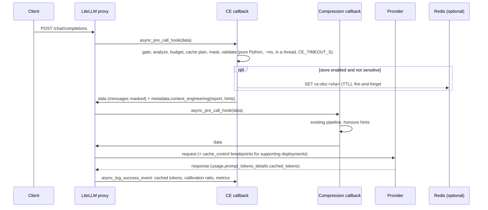

# Context Engineering for litellm-gateway: analysis and implementation blueprint

Phase one deliverable (analysis only: no source file was changed). Written 2026-11-09 against `litellm-gateway` at
commit `f3adb5e`, LiteLLM 1.106.0, and the reference repository `muratcankoylan/Agent-Skills-for-Context-Engineering`
at commit `9ff0c99`.

> **Implementation status (2026-11-10).** Implemented in `context_engineering/` (see its README). Three differences
> from this blueprint:
> - Commit `0b0aeca` (audit fixes) had already made the compression stage cache-stable
>   (`PROMPT_COMPRESSION_SELECTION_SCOPE=latest_user`, plus a cache of compressed outputs). So the
>   `history_frozen_before` hint and the `SELECTION_SCOPE=hint` change below were not needed. The only compression-side
>   change is honouring `protected_indexes`.
> - JIT retrieval (B) and compaction (D) were implemented as opt-in features (off by default) rather than deferred.
>   Compaction is extractive by default, with an optional validated background LLM summary.
> - A model without a caching flag in LiteLLM's model map is treated as caching "unknown" (history frozen), not
>   "unsupported".

Conventions used throughout:

- **EXISTING**: verified in the code or in the repository's own measured reports (file and line cited).
- **PROPOSED**: a design decision for Prompt Two. Nothing marked PROPOSED exists yet.
- No performance figure in this document is a prediction. Figures come either from this repository's own measured
  reports (cited) or from the reference repository, labelled as its heuristic or as a cited secondary source. Every
  proposed technique gets a measurement plan instead of a promised number.

---

## 1. Existing architecture summary (EXISTING)

### 1.1 Runtime shape

| Piece | Where | What it does |
|---|---|---|
| LiteLLM proxy 1.106.0 | `Dockerfile`, `docker-compose.quickstart.yml` | One container, `NUM_WORKERS=2` processes, `OMP_NUM_THREADS=4` per worker; Postgres (keys, spend logs) and Redis (shared limits, router state, cache) already in the stack |
| Callback chain | `litellm_config.yaml:404` | `["otel", "langfuse_otel", "prometheus", "observability.observed_callback.observed_prompt_compression_instance"]`; LiteLLM runs `async_pre_call_hook` of each callback **sequentially, in list order**, each returned dict replacing the request (`litellm/proxy/utils.py`, `pre_call_hook`, loop over `resolved_callbacks`) |
| Compression hook | `prompt_compression/prompt_compression_callback.py` | `CustomLogger.async_pre_call_hook`: gate, then `asyncio.wait_for(asyncio.to_thread(pipeline.process, messages), TIMEOUT_S)`; fail open (original prompt) or fail closed (HTTP 503); shadow mode; summary written to `metadata.prompt_compression` and `metadata.spend_logs_metadata.prompt_compression` |
| Observability wrapper | `observability/observed_callback.py` | Subclass of the hook: `prompt.pipeline` span (child of the LiteLLM OTel V2 server span), `prompt_pipeline_*` Prometheus metrics (`observability/metrics.py`), JSON logs with trace and request id, Langfuse attribution with hashed user id; provider result logged in `async_log_success_event` (prompt/completion tokens, cost, latency, TTFT) |
| Models | `config.yaml`, `litellm_config.yaml` | `obs-priced-llama` (Ollama llama3.2:3b with test prices), `obs-mock` (echo mock), `judge-nemotron` (OpenRouter); other models via the Admin UI/DB |
| Monitoring | `monitoring/` | OTel collector to Jaeger, Prometheus to Grafana (3 dashboards), Loki, Alertmanager; Langfuse |
| Evals | `evals/`, `reports/playground-ab/`, `reports/compression-fit/` | 23 live HTTP cases (Gate 4), a 19-check benchmark scorecard (`evals/thresholds.yaml`), A/B runs B2–B4 over 170 benchmark prompts |

Baseline test run on 2026-11-09: `prompt_compression` 190 passed, 2 failed (the two known placeholder-key cases in
`tests/test_rules.py`, documented in the README); `observability` 15 passed.

### 1.2 The reference architecture (`combined_architecture.html`)

The diagram is a **proposed** merger of this gateway with `smart-router` into one proxy with four ordered stages:

1. Auth and limits (LiteLLM built-in, Postgres + Redis).
2. Privacy and compression (this repository's `prompt_compression`).
3. Smart routing (smart-router: rule, classifier, decision, cascade; picks `tier-cheap/mid/strong`).
4. Tier groups with fallback, to Groq, Gemini, OpenRouter, Anthropic, Bedrock, Ollama.

The diagram also requires the router's own internal LLM calls to sit behind the privacy stage. The smart-router code is
not in this repository, and the two have no code references to each other yet. Context engineering slots into stage 2,
**before** smart routing. That ordering matters for caching, see §9.

---

## 2. Existing compression pipeline summary (EXISTING)

### 2.1 Request sequence

```
async_pre_call_hook (observed wrapper -> PromptCompressionCallback)
  gate.check            not chat / disabled (silent), opt-out, < MIN_TOKENS(50)          -> pass through
  pipeline.process      in a worker thread, under TIMEOUT_S (10 s)
    1 segment+classify  segmenter.split_segments: code | structured | exact | prose (lossless split)
                        sensitivity: rules.py -> topics.py -> MiniLM + logistic head (threshold 0.36)
    2 router            keep / select / compress per unit; history plan (route "history", off by default)
    3 actions           redact (opt) -> select records -> select passages (BM25) -> LLMLingua-2 on prose
    4 reassemble        blocks joined back in order with original separators; report built
  shadow? keep original : replace data["messages"]
  write metadata summary; log (no prompt text)
```

### 2.2 What is never touched (`pipeline.py:8-12`, `PRESERVED_ROLES`)

- `system` and `developer` messages.
- **`tool` and `function` results, and assistant messages carrying `tool_calls`.**
- Non-text content parts.
- `tools` definitions.
- Roles and order. The exception is the opt-in `history` route, which drops whole oldest turns.

### 2.3 Structured-data protection

- **Segmenter.** Fenced and unfenced code, JSON, JSONL, logs, tables, CSV, key=value, stack traces and
  identifier-dense text are classified as non-prose and are never compressed (`segmenter.py`).
- **Edges.** The first and last paragraph of the latest user message (instruction and question) are always kept
  (`router.route`, `protect_edges`).
- **Sensitivity.** Sensitive blocks are kept verbatim, with optional redaction.
- **Digits.** `force_reserve_digit=True` is passed to every LLMLingua-2 call (`compressor_adapter.py:60`).

### 2.4 Compression validation

What exists is **structural and ratio validation, not semantic validation**:

- **Ratio cap.** If a block compresses past `MAX_RATIO` (3.0), it gets one lighter retry; if it still exceeds the
  cap, the block is left as it was (`actions._compress_with_cap`).
- **Useless results.** An empty or not-shorter result is discarded.
- **JSON arrays.** These stay valid after record selection (`drop_trailing_comma`, with a test).
- **Pipeline failure.** Any exception or timeout means fail open (or fail closed, if configured).

There is no runtime check that identifiers or numbers survived compression. That check exists only offline, as
`key_strings_kept_pct` in `evals/score_results.py`.

### 2.5 Token counting, cost, logging, metrics

- **Token counting.** tiktoken `cl100k_base` for everything (`texts.py`). This is not the target model's tokenizer.
  It is accurate for OpenAI-family models and approximate for Anthropic, Llama and Gemini.
- **Cost.** Provider cost comes from LiteLLM's `response_cost`. The local compute estimate is
  `compute_seconds × OBS_*_HOURLY_RATE_USD` (`observed_callback.py:248`).
- **Metrics.** The `prompt_pipeline_*` family covers tokens before, after, saved and shadow-saved; compression ratio;
  classifier and compressor latency; failures; and model load. Labels are low-cardinality only, enforced by
  `ALLOWED_LABELS`.
- **Not captured anywhere:** provider-side prompt-cache tokens. LiteLLM normalises them into
  `usage.prompt_tokens_details.cached_tokens` (OpenAI, DeepSeek, Anthropic read) and Anthropic's
  `cache_creation_input_tokens`. Neither is logged or exported.

### 2.6 Measured results (from the repository's own reports)

**Token savings** (`reports/playground-ab/REPORT.md`, B2):

- prompt tokens −27.5% overall;
- QA −35%, logs −63%, code 0%, PII 0%;
- 0 answers lost on 69 changed prompts.

**Overhead and throughput:**

| Measure | Value | Source |
|---|---|---|
| Pipeline overhead | 22 ms p50, 0.43 s p95 | B2 |
| Echo-model throughput, uncompressed | 42–48 req/s | B3, after fixes |
| Echo-model throughput, compressed (2 × 4) | 12.7–13.1 req/s | B3, after fixes |
| Real model (Ollama 3B): throughput | +39% to +55% faster with compression | — |
| Real model (Ollama 3B): mean latency | −3.4 s | — |

**Sensitivity head v2:** test recall 0.973 at a false-positive rate of 0.099; QA passages false-positive rate 0.006.

### 2.7 Bottlenecks and limitations (verified)

| # | Limitation | Evidence | Relevance to context engineering |
|---|---|---|---|
| L1 | CPU model inference caps capacity: compressed traffic reaches about 27–30% of uncompressed req/s with an instant model | `evals/REPORT.md` §0, §4.1 | Context engineering must be cheap (deterministic, no model calls on the hot path), and should **reduce** the text that reaches LLMLingua-2 |
| L2 | LLMLingua-2 is the whole latency tail (0.2–1 s per call) | `evals/REPORT.md` §4.4 | Removing text earlier shortens the tail |
| L3 | **Tool results are never reduced** | `PRESERVED_ROLES` | In agentic traffic this is the largest unmanaged category; observation masking targets it |
| L4 | **Query-dependent rewriting of older messages.** `passages` and `records` selection run on every eligible message, ranked against the *latest* question (`router.route` collects candidates from all units; `test_records_are_selected_using_the_question_of_the_latest_message` selects inside message 0) | `router.py:40-73` | In a multi-turn conversation, message 0 is rewritten differently on every turn, so the provider's cached prefix breaks at message 0 on every request |
| L5 | `history` trimming is a sliding window: once over budget, the drop point moves every turn. It also stops at the first tool-related turn | `selectors.trim_history` | Each request changes the prefix start, so caches miss. In agent loops (tools in every turn) it rarely trims anything |
| L6 | No awareness of the model's context window, the `tools` token cost, or `max_tokens` reserve | `gate.py`, `settings.py` | A budget manager is missing |
| L7 | No provider prompt-caching configuration or measurement | `litellm_config.yaml`; no `cached_tokens` in `observability/` | Caching has no configuration and no measurement |
| L8 | Evaluations are single-turn, with no tools and no streaming | `evals/REPORT.md` §5, `reports/playground-ab/REPORT.md` §6 | Multi-turn and agentic evaluation must be built before any context technique is enforced |
| L9 | The token counter is cl100k for all models | `texts.py` | Budgets need a safety margin, or calibration against `usage.prompt_tokens` |

### 2.8 Exact integration locations

| Location | Why there |
|---|---|
| `litellm_config.yaml` `callbacks` (and `config.yaml`): a new callback **before** `observed_prompt_compression_instance` | Sequential pre-call hooks: context engineering runs first, compression sees the reduced request; zero edits to compression code for the first phases |
| `observability/observed_callback.py` `_log_provider_result` / `async_log_success_event` | Read `response_obj.usage.prompt_tokens_details.cached_tokens` and `cache_creation_input_tokens` |
| `prompt_compression/router.py:route` (candidate collection) and `PromptPipeline.process` | Small additive change: restrict query-dependent selection to the "live" suffix when history is frozen (fixes L4) |
| `litellm_params.cache_control_injection_points` per model (LiteLLM built-in `anthropic_cache_control_hook.py`, supports `location: message` with `role` or `index`) | Provider-specific cache breakpoints, applied after the pre-call hooks on the final messages |
| `docker-compose.quickstart.yml` | Mount `./context_engineering`, pass `CE_*` variables; Redis already present |
| `prompt_compression/selectors.py` `rank_units`, `trim_history`; `embedding_classifier.EmbeddingEncoder` (loaded once per worker through `get_detector()`) | Reusable for later phases (turn ranking, block-wise trimming) without new dependencies |

---

## 3. Reference repository analysis

Skills read (each as `SKILL.md`, plus its `references/` and `scripts/` where present):

- context-fundamentals
- context-optimization
- context-compression
- context-degradation
- filesystem-context
- memory-systems
- evaluation
- also: self-managed-context, multi-agent-patterns, tool-design

**Important caveats:**

- **Unsourced numbers.** Most thresholds in the repository are its own heuristics, without a primary source. Its claim
  registry rates most cited claims as "secondary": they point to the repository's own digests, not to papers.
- **Demo code.** The Python scripts are demonstrations. The attention measurement uses `random.random()`, the vector
  store uses hash-seeded random vectors, and the LLM judge is a stub.
- **What to take from it:** mechanisms and data-structure sketches, not code or numbers.

### 3.1 Technique by technique

| Technique | Mechanism (repo) | Practical requirements in a proxy | Benefit | Limitations / repo flaws found | Suitability here |
|---|---|---|---|---|---|
| **Context budgeting** | Per-category budgets: tool outputs 35%, history 30%, retrieved 20%, buffer 15% (example YAML), against an *effective* limit below the nominal window. Trigger tiers: 70% warn, 80% compact, 90% aggressive. Use a real tokenizer, not chars/4 | Model window from `litellm.get_model_info`, `max_tokens` reserve, tiktoken per category, calibration against `usage.prompt_tokens` (repo: clamped ratio 0.5–3.0) | Enables everything else; prevents context-window errors | All percentages are **repo heuristics**, and the repo is inconsistent (buffer 5–10%, 15%, or a fixed 5000 tokens) | **High.** Use as a trigger and planner, with configurable numbers |
| **Just-in-time retrieval** | "Maintain an index, not a copy"; progressive disclosure; load on demand through tools | The proxy cannot add tools the client executes; history is already re-sent by the client on every request | Large in agent harnesses that own the tools | The repo itself lists it as **requiring agent cooperation** | **Low** as a gateway feature. A gateway-side variant (select relevant old turns) conflicts with caching (§4) |
| **Observation masking** | Replace stale verbose tool outputs with `[Obs:{ref} elided. Key: …]`. Never mask the most recent turn, observations in active reasoning, or errors while debugging; mask after 3+ turns; mask duplicates immediately | Deterministic stub; content-hash ids (the repo's ids are `md5(content[:100]+time.time())`, which is **non-deterministic and breaks caching**); keep `tool_call_id` pairing | Largest token reduction in tool-heavy traffic. The repo's "60–80%" figure is an unverified heuristic | Retrieval needs a tool round-trip (agent cooperation). Without it, masking is elision; the agent can re-run its own tool | **High**, with batching and hysteresis |
| **Context compaction** | Anchored iterative summarization: persistent structured sections (intent, files created/modified/read, exact identifiers and errors, decisions + rationale, current state, next steps, ruled-out); summarize only the newly truncated span and merge; never re-summarize the summary. Triggers: 70–80%, sliding window (default for coding agents), task boundary | A side LLM call (latency, cost, privacy), a store keyed by a hash of the replaced span, validation of identifiers against the source | Large on long chats | Summaries "round" paths, codes and numbers; they can carry self-injected instructions (self-managed-context, citing an OpenAI alignment report); the Factory benchmark is a vendor self-benchmark | **Medium.** Later phase, asynchronous, opt-in, validated |
| **KV-cache optimization** | Fixed order: system, tools, templates, history, query. No timestamps or ids in the system prompt. Any edit to earlier history costs re-prefill of everything after it, so batch edits and prefer edits near the end (self-managed-context: an edit at the start of a 20K-token prompt costs 7.7x an append, illustrative) | Stop rewriting history per request (L4, L5); provider breakpoints via LiteLLM; measure `cached_tokens` | Lower billed input cost and TTFT on caching providers, **without** removing tokens | Provider-specific (minimum prefix length, TTL, discount); Ollama reuses its own KV prefix locally | **Highest priority, lowest risk** (the repo ranks it first too) |
| **Context partitioning** | Sub-agents with isolated contexts when context exceeds about 60% of the window; break-even needs 3+ subtasks; multi-agent costs about 15x the tokens of chat (cited, secondary) | An orchestrator that owns task decomposition | Isolation | The coordinator lives in the agent, not the proxy | **Not suitable** for the gateway (§4.6) |
| **Memory management** | Tiers: working, short-term, long-term, entity, temporal knowledge graph; "pick the shallowest tier that works" | Storage plus identity per conversation or user | Cross-session continuity | Out of scope for a request optimizer; privacy load | **Only** short-term session state (compaction summaries, observation store) in Redis with TTL |
| **Lost-in-the-middle** | U-shaped recall; critical information at the edges (Liu et al., 10–40%, cited secondary) | Placement control | Quality | The gateway should not reorder user content | Already handled for the question (edge protection keeps it last). Masking shortens the middle. No reordering proposed |
| **Poisoning / distraction / confusion / clash** | Poisoning: a bad fact compounds, so remove it rather than layering corrections. Distraction: even one distractor hurts. Clash: contradictory sources need precedence | Mostly needs app knowledge | Quality | The proxy cannot tell which tool output was wrong | Partly: masking stale outputs and folding duplicates reduces distraction; guard against instruction-shaped text in generated summaries |
| **Evaluation** | Tokens-per-task, not tokens-per-request; re-fetch rate as the main signal of over-compression; probe-based evaluation (recall, artifact, continuation, decision) with a blinded judge from another model family; deterministic checks before any judge; degradation sweeps | Multi-turn agentic dataset; logged re-fetches | Protects quality | — | **Required.** Extends the existing Gate 4 and scorecard approach |

### 3.2 What the repository gets right for this project

- **Ordering of value and risk.** Cache first, then masking, then compaction, then partitioning. This matches the
  constraint that L1 forbids heavy hot-path work.
- **Edit-cost rule.** "Edits to early context are expensive." This exposes an existing defect (L4, L5) in this
  gateway's history handling.
- **Tokens-per-task and re-fetch rate.** These are better quality signals for agents than per-request compression
  ratio.

### 3.3 What must not be copied

- **The masking id scheme.** It is time-based and breaks the cache.
- **`truncate_messages`.** It keeps only the last system message, produces non-contiguous history, and orphans tool
  calls.
- **`categorize_messages`.** It keys on `msg["type"]`, not the OpenAI `role`.
- **The random attention and embedding stubs.**
- **Unsourced percentages presented as targets.**

---

## 4. Technique evaluation and ranking

Scores are qualitative. They are an engineering judgement from the code and the repository, not measurements:
H = high, M = medium, L = low. For risk and complexity, L is better.

| Technique | Token reduction | Latency | Cost | Throughput | Quality / retention risk | Complexity | Infrastructure | Rank |
|---|---|---|---|---|---|---|---|---|
| **D. Cache-aware construction** | none (L) | H on caching providers (prefill skipped) | H on caching providers | M (less provider prefill; zero gateway CPU) | **none**: no content removed | **L** | none (LiteLLM built-in, config) | **1** |
| **B. Observation masking + duplicate folding** | H on tool-heavy traffic, none otherwise | M (shorter prefill) | H on tool-heavy traffic | M (ms of gateway CPU) | M, controlled by recency guard, error guard, verbatim key lines | M | none required (Redis optional) | **2** |
| **E. Budget manager** | indirect (trigger) | indirect | indirect | none | none by itself | L | none | **3** (enabler, ships with 2) |
| **C. Compaction (anchored, async)** | H on long chats | M (async off the hot path; adds a side call) | M (side-call cost offsets savings) | L | **H** (summarizer loss, hallucinated ids, injection) | **H** | Redis + summarizer model | **4** (opt-in, later) |
| **A. JIT retrieval of old turns** | M | M | M, **negative** on caching providers (breaks prefix) | L (embedding call) | H (coreference, multi-hop; the repo calls it agent-side) | M | none (BM25 / MiniLM already present) | **5** (non-caching providers only, later) |
| **F. Partitioning** | — | — (more calls) | negative (the repo cites about 15x tokens) | — | — | very high | orchestrator | **not implemented** |

### 4.1 Why cache-awareness comes first even though it removes no tokens

On a provider with prefix caching, cached input tokens are billed at a provider-specific discount. Cache writes may
carry a surcharge (Anthropic), so check each provider's pricing page. The effective input cost is:

```
cost_in = p * (uncached_tokens + w * cache_write_tokens + r * cache_read_tokens)      (w >= 1, r < 1; provider-specific)
```

**Consequence.** A token-removing technique that edits early history can **raise** `cost_in`, because it turns cheap
`cache_read_tokens` into full-price `uncached_tokens` for everything after the edit. That is why L4 and L5 matter, and
why every proposed reduction must be deterministic, monotonic and batched.

**Measuring it.** Prompt Two will measure this with `cached_tokens` from provider usage. No saving is claimed here.

### 4.2 Recommended initial implementation

1. **D** (cache-aware construction): measurement, provider breakpoints, history freeze.
2. **E** (budget manager): reporting and planning; in the first release it only triggers B.
3. **B** (observation masking + duplicate folding): shadow mode first.

**Deferred:** C (phase 4, opt-in) and A (phase 5, opt-in, non-caching providers only). F is rejected.

### 4.3 Per-technique decisions

- **A. JIT retrieval.** In a stateless proxy the client re-sends the whole history, so "retrieval" means selecting
  older turns. That is query-dependent, which breaks caching, and the repository calls it agent-side. Two uses remain:
  - the agent's own tools act as retrieval for masked content (the stub says how to get it back);
  - optional turn selection when the provider has no prompt caching **and** the budget is under high pressure.
- **B. Observation masking.**
  - Always applies to byte-identical duplicates.
  - Age-based masking of large, older tool results, in batches.
  - No model call.
- **C. Context compaction.** Only after B has proven itself in shadow mode. It runs asynchronously after the response,
  with a configured summarizer (default: a local model, so no text leaves the host). The summary is accepted only if
  every identifier and number in it appears verbatim in the source span.
- **D. KV-cache optimization.** Ordering is already system first (the gateway never reorders). The work is:
  - stop query-dependent edits to history;
  - batch edits;
  - add breakpoints;
  - detect volatile system prompts;
  - measure.
- **E. Budget management.** Configurable fractions, an effective target below the window, and pressure levels that
  choose the active techniques.
- **F. Context partitioning.** Rejected for the gateway. The proxy cannot decompose tasks, run sub-agents or merge
  results without becoming an agent framework. The coordination overhead is documented, and there is no measurable
  benefit at the proxy layer.

---

## 5. Proposed combined architecture (PROPOSED)

### 5.1 Adjustments to the conceptual flow from the brief

- **Cache-awareness splits into two parts.**
  - A **planner** in context engineering (CE) decides the frozen prefix boundary and keeps all edits outside it, or
    batched.
  - A **finalizer** in LiteLLM (`cache_control_injection_points`) places provider breakpoints after model routing,
    because breakpoints depend on the deployment that is finally chosen.
- **JIT retrieval and compaction are later, optional stages.** The first release has Analyzer, Budget, Cache planner,
  Masking and Validator.
- **CE is its own callback**, registered before the compression callback. This gives it an independent fail-open and
  kill switch, with no rewrite of `prompt_compression`. CE hands hints to compression through request metadata.
- **Compression gains one small, additive behaviour.** It honours `history_frozen_before` and `protected_indexes` from
  CE (default: no change).

### 5.2 Architecture diagram

```mermaid
flowchart TD
    C[Client request<br/>messages + tools + metadata] --> AUTH[LiteLLM auth, limits, budgets<br/>EXISTING]
    AUTH --> CEH

    subgraph CEH[context_engineering callback - PROPOSED]
        direction TB
        G0[CE gate<br/>enabled, chat call, opt-out, min tokens] --> AN[Context Analyzer<br/>categories, tokens, turn and tool-call graph,<br/>prefix fingerprint]
        AN --> BM[Context Budget Manager<br/>model window, output reserve,<br/>category limits, pressure level]
        BM --> CP[Cache Planner<br/>frozen prefix boundary, caching support,<br/>volatile-prefix detection]
        CP --> OM[Observation Masking<br/>duplicate folding, age-based batched masking,<br/>verbatim key lines]
        OM -.phase 4.-> CC[Compaction<br/>apply stored anchored summary]
        CC -.phase 5.-> JR[JIT turn selection<br/>non-caching providers only]
        OM --> VAL[Invariant Validator<br/>tool-call pairing, latest user and system unchanged,<br/>tokens not increased]
        JR -.-> VAL
        VAL -->|fail| REV[Revert to original request<br/>status=error, fail open]
        VAL -->|ok| HINT[Write metadata.context_engineering<br/>report + hints]
    end

    HINT --> PCH
    REV --> PCH

    subgraph PCH[prompt_compression callback - EXISTING, plus honouring hints]
        direction TB
        PG[Gate] --> SEG[Segment and classify<br/>structured-data guard, sensitivity]
        SEG --> RT[Router<br/>selection limited to live suffix when history is frozen]
        RT --> ACT[Actions<br/>records and passages selection, LLMLingua-2 on prose,<br/>ratio-cap validation]
        ACT --> RA[Reassemble + report]
    end

    RA --> SR[Smart routing - reference architecture, not in this repo]
    SR --> LR[LiteLLM model routing and deployment choice]
    LR --> CCI[LiteLLM cache_control_injection_points<br/>provider breakpoints - EXISTING feature, new config]
    CCI --> P[LLM provider]
    P --> M[Response + metrics<br/>prompt_pipeline_* EXISTING, context_engine_* PROPOSED,<br/>cached_tokens and cache writes PROPOSED]
    M -.async, phase 4.-> SUM[Summarizer worker<br/>anchored summary, validation] --> ST[(Redis ce:* keys, TTL<br/>EXISTING service)]
    ST -.-> CC
    OM -.optional audit store.-> ST
```



### 5.3 Request sequence



### 5.4 Component responsibilities and interfaces

All CE components are pure functions over plain data and never mutate their input: the engine deep-copies once. Only
the callback touches LiteLLM.

| Component | Module | Responsibility | Interface |
|---|---|---|---|
| CE callback | `context_engineering/callback.py` | LiteLLM `CustomLogger`. Gate, timeout, fail open/closed, shadow mode, metadata, logging; reads provider usage in `async_log_success_event`. Must define `async_pre_call_hook` in its own class (LiteLLM checks `vars(cls)`) | `async_pre_call_hook(user_api_key_dict, cache, data, call_type) -> dict` |
| Engine | `engine.py` | Runs the stages in order; per-stage try/except (a failing stage is skipped and reported); builds the report | `ContextEngine.process(messages, tools, model, max_tokens, metadata) -> tuple[list, ContextReport]` |
| Analyzer | `analyzer.py` | Classify every message and the `tools` param into categories; count tokens (reusing `prompt_compression.texts.count_tokens`, with a content-hash LRU); build turn indexes and the tool-call graph (`tool_call_id` to message index); fingerprint the prefix | `analyze(messages, tools, model) -> ContextProfile` |
| Budget Manager | `budget.py` | Effective target, category limits, utilization, pressure level, techniques enabled for this request | `plan(profile, settings) -> BudgetPlan` |
| Cache Planner | `cache_planner.py` | Does the model support prompt caching (`litellm.supports_prompt_caching`, unknown means assume yes)? Where does the frozen prefix end? Does the system prompt contain volatile tokens (detect only)? | `plan_cache(profile, settings) -> CachePlan` |
| Observation Masker | `masking.py` + `extract.py` | Duplicate folding and age-based batched masking of eligible tool results; deterministic stub with verbatim key lines | `mask(messages, profile, budget, cache_plan, settings) -> MaskResult` |
| Store | `store.py` | `ObservationStore` protocol: `NullStore` (default), `MemoryStore` (LRU), `RedisStore` (`ce:obs:<sha>`, TTL). Writes are fire-and-forget and never block | `put(ref, text, ttl)`, `get(ref)` |
| Validator | `validate.py` | Invariants (§5.8); on any failure the engine returns the original messages | `check(original, result, profile) -> list[str]` |
| Metrics | `observability/context_metrics.py` | `context_engine_*` counters and histograms, labels within `ALLOWED_LABELS` style rules | — |
| Compaction (phase 4) | `compaction.py` | Find a stored summary for an exact span; schedule summarization after the response; validate summaries | `apply(messages, profile, store)`, `schedule(...)` |
| Turn selection (phase 5) | `retrieval.py` | Rank old turns against the query (BM25 `rank_units`, optional MiniLM via the detector's encoder) | `select_turns(...)` |

### 5.5 Data structures

```python
class Category(str, Enum):
    SYSTEM = "system"; TOOL_DEFS = "tool_definitions"; HISTORY = "history"; TOOL_OUTPUT = "tool_output"
    RETRIEVED = "retrieved"; QUERY = "current_query"; SUMMARY = "summary"

@dataclass(frozen=True)
class ContextItem:
    index: int                 # position in the original messages list (-1 = the tools param)
    role: str
    category: Category
    tokens: int                # cl100k estimate, times the calibration ratio when one is known
    turn: int                  # number of user messages before it
    content_sha: str           # sha256 of the text content (hex, used for refs and duplicate detection)
    tool_name: str | None      # from the matching assistant tool_call
    tool_call_id: str | None
    tool_rank: int | None      # 0 = newest tool result, 1 = the one before, ...
    is_error: bool             # tool output that looks like an error (Traceback, ERROR, exit code != 0, ...)
    pinned: bool               # never edited: system/developer, first user message, latest user message,
                               # tool results after the last assistant message

@dataclass(frozen=True)
class ContextProfile:
    model: str
    window: int | None         # litellm.get_model_info(model)["max_input_tokens"], None when unknown
    output_reserve: int        # data["max_tokens"] or CE_OUTPUT_RESERVE_TOKENS
    items: tuple[ContextItem, ...]
    totals: Mapping[Category, int]
    total_tokens: int
    prefix_sha: str            # sha256 of system/developer messages + canonical JSON of tools
    conversation_key: str      # salted sha256 of (prefix_sha + first user message): an identity for metrics/store
    volatile_prefix: tuple[str, ...]   # names of volatile patterns found in system messages ("iso_datetime", "uuid")

@dataclass(frozen=True)
class BudgetPlan:
    target_tokens: int         # min(window - output_reserve, window * CE_TARGET_UTILIZATION) or CE_DEFAULT_TARGET
    limits: Mapping[Category, int]
    utilization: float         # total_tokens / target_tokens
    pressure: Literal["none", "low", "high", "critical"]
    techniques: frozenset[str] # e.g. {"dedupe", "mask"}; {"dedupe", "mask", "trim"} at critical

@dataclass(frozen=True)
class CachePlan:
    caching: Literal["supported", "unsupported", "unknown"]
    frozen_before: int         # messages[:frozen_before] must not be edited by query-dependent steps this request
    batch: int                 # edit-batch size used by masking (hysteresis)

@dataclass(frozen=True)
class MaskRecord:
    index: int; tool_call_id: str; tool_name: str; ref: str   # ref = "obs_" + content_sha[:12]
    reason: Literal["duplicate", "age"]; tokens_before: int; tokens_after: int; stored: bool

@dataclass
class ContextReport:
    status: str                # ok | shadow | skipped | error
    tokens_before: int; tokens_after: int
    by_category_before: dict; by_category_after: dict
    utilization: float; pressure: str; caching: str
    masked: list[MaskRecord]; stages_failed: list[str]; invariant_violations: list[str]
    elapsed_ms: float
    hints: dict                # {"history_frozen_before": int, "protected_indexes": [int, ...]}
```

### 5.6 Metadata contract between CE and compression

```json
"metadata": {
  "context_engineering": {
    "status": "ok", "tokens_before": 41200, "tokens_after": 18350, "pressure": "low", "caching": "supported",
    "masked": [{"index": 7, "ref": "obs_3f9a1c2b7d10", "reason": "age", "tokens_before": 4812, "tokens_after": 96}],
    "hints": {"history_frozen_before": 12, "protected_indexes": [7, 9]}
  },
  "spend_logs_metadata": {"context_engineering": {"...": "same summary, no text"}}
}
```

- **Opt-outs.** `metadata.context_engineering=false` skips CE only. The existing `metadata.prompt_compression=false`
  keeps skipping compression only. Internal calls (judge, summarizer, smart-router internals) set both.
- **Missing or garbled hints** mean compression behaves exactly as today (backward compatible).

### 5.7 Observation masking: exact rules

**Eligible.**

- The message has `role` `tool` or `function` and text content.
- It has at least `CE_MASK_MIN_TOKENS` tokens (default 400).
- It is not pinned: not a result of the current agent step, i.e. not after the last assistant message.
- It is not an error output among the newest `CE_MASK_ERROR_GUARD` tool results (default 3; the repository's "errors
  while debugging" rule).

**Duplicate folding** (reason `duplicate`). If a later tool result is byte-identical (same `content_sha`) to an earlier
one, the **later** one becomes:

```
[duplicate of observation obs_<sha12> (message #<n>); identical content omitted]
```

The earlier copy stays, so the prefix is unchanged. No information is lost, because the content is present above.

**Age masking** (reason `age`, with hysteresis).

1. Let `E` be the eligible non-duplicate results, oldest first, and `N = len(E)`.
2. Keep the newest `K = CE_MASK_KEEP_RECENT` (default 3) unmasked.
3. Mask `E[i]` iff `i < floor((N - K) / B) * B`, where `B = CE_MASK_BATCH` (default 4).

The masked set grows only every `B` new tool results, and an item never becomes unmasked again. This is the
repository's "batch edits" rule made deterministic, so consecutive requests share a byte-identical prefix.

**Stub.** Deterministic and verbatim-only; no paraphrase, no model:

```
[observation obs_3f9a1c2b7d10 masked by gateway: tool=run_tests, 4812 tokens, 311 lines]
Key lines (verbatim):
FAILED tests/test_api.py::test_login - AssertionError: 401 != 200
...
[Full output omitted to save context. Call the tool again if the complete output is needed.]
```

Key lines come from `extract.py`:

- error, failure and warning lines and the last lines of stack traces;
- lines containing identifiers that the **immediately following** assistant message mentions (this message is fixed
  once written, so the stub is stable);
- the first and last `CE_MASK_HEAD_TAIL_LINES` lines;
- for JSON: the top-level keys and array lengths (structure only, values untouched).

All of this is capped at `CE_MASK_STUB_MAX_TOKENS` (default 150).

**Never altered:**

- the `tool_call_id`, `name` and role;
- the assistant `tool_calls`;
- the message count and order.

**Storage.** `NullStore` by default. The client already holds the full history and re-sends it on every request, so
nothing needs to be stored for correctness. `RedisStore` is an opt-in audit and debug aid. It never stores content
with a rules hit (`sensitivity.deterministic_hits`), and the TTL defaults to 1 h.

### 5.8 Invariants (the CE validator; any violation reverts to the original)

1. Same number of messages and the same roles in the same order (phases 1–3; compaction in phase 4 has its own span
   invariant).
2. Every `tool` message keeps its `tool_call_id`, and it still matches an id in a preceding assistant `tool_calls`.
3. System and developer messages, the first user message, the latest user message and `tools` are byte-identical.
4. Every masked message's new text is shorter than its original text.
5. Total tokens after are no greater than before.
6. The result is JSON-serialisable.

### 5.9 Configuration (PROPOSED; all optional, listed in a new `context_engineering.env.example`)

| Variable | Default | Meaning |
|---|---|---|
| `CE_ENABLED` | `true` | Global switch; `false` means pass through, silently |
| `CE_MODE` | `shadow` | `shadow` reports what it would do and sends the original; `enforce` applies it |
| `CE_FAIL_MODE` | `open` | `open`: original request plus a warning; `closed`: HTTP 503 |
| `CE_TIMEOUT_S` | `1.0` | Budget for the CE stage (pure Python) |
| `CE_MIN_TOKENS` | `1000` | Requests below this skip CE |
| `CE_TECHNIQUES` | `dedupe,mask` | Active: `dedupe`, `mask`, `trim`, `compact`, `select_turns` |
| `CE_TARGET_UTILIZATION` | `0.7` | Effective target as a share of the window (repo heuristic, tune it) |
| `CE_DEFAULT_TARGET_TOKENS` | `24000` | Target when the model's window is unknown (virtual names such as `smart-*`) |
| `CE_OUTPUT_RESERVE_TOKENS` | `4096` | Reserve when the request has no `max_tokens` |
| `CE_BUFFER_FRACTION` | `0.10` | Reserved buffer inside the target |
| `CE_LIMIT_TOOL_OUTPUT` / `_HISTORY` / `_RETRIEVED` | `0.40` / `0.35` / `0.15` | Soft category caps (shares of target). System, tools and query are never cut, only reported |
| `CE_PRESSURE_LOW` / `_HIGH` / `_CRITICAL` | `0.5` / `0.8` / `0.95` | Utilization thresholds |
| `CE_MASK_TRIGGER` | `always` | `always`, or `pressure` (mask only at `high` and above) |
| `CE_MASK_MIN_TOKENS` / `_KEEP_RECENT` / `_BATCH` / `_ERROR_GUARD` | `400` / `3` / `4` / `3` | Masking rules (§5.7) |
| `CE_MASK_STUB_MAX_TOKENS` / `_HEAD_TAIL_LINES` | `150` / `3` | Stub size |
| `CE_STORE` | `none` | `none`, `memory`, or `redis` (uses the existing `REDIS_HOST/PORT/PASSWORD`) |
| `CE_STORE_TTL_S` | `3600` | Store TTL |
| `CE_FREEZE_HISTORY` | `auto` | `auto` (freeze when caching is supported or unknown), `always`, or `never`; feeds `history_frozen_before` |
| `CE_HASH_SALT` | `OBS_HASH_SALT` | Salt for the conversation key |
| (phase 4) `CE_SUMMARIZER_MODEL`, `CE_COMPACT_KEEP_TURNS`, `CE_COMPACT_TRIGGER` | `obs-priced-llama` / `6` / `0.8` | Compaction |

**Compression-side, proposed:** `PROMPT_COMPRESSION_SELECTION_SCOPE = all | live` (default `all` = today's
behaviour). `live` limits `passages` and `records` selection to messages at or after `history_frozen_before`, or to the
latest user message when there is no hint.

**LiteLLM config, proposed, per caching-capable deployment:**

```yaml
- model_name: claude-sonnet            # example; any Anthropic / Bedrock-Claude entry
  litellm_params:
    model: anthropic/<model-id>
    api_key: os.environ/ANTHROPIC_API_KEY
    cache_control_injection_points:
      - location: message
        role: system                   # breakpoint after the stable system prompt (tools precede it in the request)
      - location: message
        index: -2                      # second breakpoint on the last stable history message (verify behaviour in Prompt Two)
```

OpenAI-family models cache automatically above a provider minimum. LiteLLM passes `prompt_cache_key` through
(`gpt_transformation.py`). CE may set it to the salted conversation key (opt-in `CE_SET_PROMPT_CACHE_KEY`, to be
verified).

### 5.10 Storage requirements

| Phase | Storage | Notes |
|---|---|---|
| 0–3 | **None required.** Per-worker in-memory LRU for token counts by content hash, and for calibration ratios by model | No new service |
| 3 (optional) | Redis `ce:obs:<sha>` with TTL | Audit only; skipped for rule-hit content |
| 4 | Redis `ce:sum:<span_sha>`: summary JSON + metadata, TTL 24 h | The existing Redis; distinct key prefix; size cap per entry |
| Metrics | Prometheus (existing) | Low-cardinality labels |

### 5.11 Error handling and fallbacks

- **Isolation.** Each stage runs in its own try/except. A failing stage is recorded in `stages_failed` and later stages
  continue on the last good messages.
- **Validator failure.** The whole CE result is discarded and the original request is forwarded, with
  `status=error, reason=invariant:<name>`.
- **Timeout or unexpected exception.** Follows `CE_FAIL_MODE`. The default is open, and compression still runs
  afterwards, exactly as today.
- **Redis down.** Store writes are dropped, with a counter and no retry on the hot path; request behaviour is
  unchanged.
- **Unknown model window.** Uses `CE_DEFAULT_TARGET_TOKENS`.
- **Unknown caching support.** Treated as `unknown`: freeze history (the safe default).
- **Kill switches.** `CE_ENABLED=false` (global), `metadata.context_engineering=false` (per request),
  `CE_MODE=shadow` (rollout).

---

## 6. Implementation blueprint per selected technique

### 6.1 D. Cache-Aware Prompt Construction (phase 1)

| Item | Detail |
|---|---|
| Modules | `context_engineering/cache_planner.py`, `analyzer.py` (prefix fingerprint, volatile detection); changes in `observability/observed_callback.py` (cached tokens); `prompt_compression/router.py` + `settings.py` (`SELECTION_SCOPE`); `litellm_config.yaml` (injection points) |
| Responsibility | Keep the cacheable prefix byte-stable across turns; tell compression where history is frozen; add provider breakpoints; measure cache reads and writes |
| Input / output | `ContextProfile` → `CachePlan`; hints in metadata |
| Dependencies | `litellm.supports_prompt_caching`, `litellm.get_model_info` (installed); no new packages |
| Integration | New callback before compression; additive change in compression's router; config only for breakpoints |
| Configuration | `CE_FREEZE_HISTORY`, `PROMPT_COMPRESSION_SELECTION_SCOPE`, `cache_control_injection_points`, `CE_SET_PROMPT_CACHE_KEY` |
| Expected impact | No token change. Fewer prefix invalidations should raise `cached_tokens` share on caching providers and cut TTFT. **To be measured**: metrics `context_engine_provider_cached_tokens_total`, `context_engine_prefix_changes_total`, and TTFT from the existing log event |
| Tests | Unit: the same conversation at turn n and n+1 produces byte-identical `messages[:frozen_before]` after CE and compression; `SELECTION_SCOPE=all` reproduces current outputs exactly (golden test over the existing test fixtures); volatile-pattern detector cases. Live: a multi-turn run against Ollama (local prefix reuse) and, where a key exists, an Anthropic or OpenAI model, comparing `cached_tokens` and TTFT between `SELECTION_SCOPE=all` and `live` |
| Risks | Freezing history lowers compression savings on documents pasted in early turns (they are no longer re-selected per question). The trade-off depends on provider pricing, so it is configurable, and `auto` uses caching support. Breakpoint semantics differ per provider; LiteLLM handles translation, so verify with a live request |

### 6.2 E. Context Budget Manager (phase 2, ships with masking)

| Item | Detail |
|---|---|
| Modules | `context_engineering/analyzer.py`, `budget.py`, `settings.py` |
| Responsibility | Per-category token accounting (system, tool definitions, history, tool outputs, retrieved, current query); effective target; pressure; technique selection |
| Input / output | `messages`, `tools`, `model`, `max_tokens` → `ContextProfile`, `BudgetPlan` |
| Dependencies | tiktoken (installed), via `prompt_compression.texts.count_tokens` |
| Calibration | In `async_log_success_event`, `ratio = usage.prompt_tokens / tokens_after_estimate`, clamped to [0.5, 3.0] (the repo's rule), kept per model as an EWMA in memory; budgets use `estimate × ratio` |
| Configuration | `CE_TARGET_UTILIZATION`, `CE_DEFAULT_TARGET_TOKENS`, `CE_OUTPUT_RESERVE_TOKENS`, `CE_BUFFER_FRACTION`, `CE_LIMIT_*`, `CE_PRESSURE_*` |
| Expected impact | Reporting plus triggers; no direct saving. Gives the first real measurement of where tokens go on live traffic (shadow) |
| Tests | Category attribution over hand-built OpenAI arrays (multi-part content, tool calls, function role, developer role); unknown model window; `max_tokens` present or absent; pressure thresholds; calibration clamp |
| Risks | cl100k is not the provider tokenizer (L9), so calibration and buffer are mandatory. Do not reject or truncate requests on a budget overrun in phase 2: report only |

### 6.3 B. Observation Masking + Duplicate Folding (phase 3)

| Item | Detail |
|---|---|
| Modules | `context_engineering/masking.py`, `extract.py`, `store.py`, `validate.py` |
| Responsibility | §5.7 rules: fold exact duplicates; mask aged large tool results in batches; deterministic verbatim stubs; optional audit store |
| Input / output | `messages`, `ContextProfile`, `BudgetPlan`, `CachePlan` → masked `messages`, `list[MaskRecord]` |
| Dependencies | stdlib (`hashlib`, `json`, `re`); `redis` (already installed with LiteLLM) only when `CE_STORE=redis` |
| Integration | Engine stage after the cache planner; compression already leaves tool messages untouched, so nothing else changes |
| Configuration | `CE_TECHNIQUES`, `CE_MASK_*`, `CE_STORE*` |
| Expected impact | Removes tokens only where large tool outputs exist. Zero effect on today's single-turn benchmark families (they contain no tool messages). **To be measured** in shadow mode on real or replayed agent traffic: `context_engine_tokens_saved_total{technique}`, re-fetch rate (the same tool with the same arguments called again after its output was masked), task success on the multi-turn eval |
| Tests | Unit: tool-call pairing intact; latest step never masked; error guard; duplicate folding keeps the first copy; hysteresis: the stub set at N+1 equals the set at N unless the batch boundary is crossed; determinism (the same input yields the same bytes twice, across processes); key-line extraction keeps exact strings; JSON outputs; multi-part tool content; stub shorter than original. Eval: a multi-turn agentic replay set (§8, phase 3) with probes (recall, artifact, continuation, decision) comparing masked and original, plus the re-fetch metric |
| Risks | The model needs a detail that was masked, so it re-runs the tool (more calls, which is why re-fetch rate is a gate metric) or answers wrongly. Mitigations: recency, error guard, key lines from the following assistant message, conservative defaults, shadow first. Clients that inspect echoed history are unaffected, because the gateway never changes the client's stored copy |

### 6.4 C. Compaction (phase 4, opt-in; outline for later)

| Item | Detail |
|---|---|
| Modules | `context_engineering/compaction.py`, `summary_schema.py` |
| Mechanism | Anchored iterative structured summary of the span `messages[a:b]` (after the pinned first user message, before the last `CE_COMPACT_KEEP_TURNS` turns), written **asynchronously after the response** with `CE_SUMMARIZER_MODEL` through the proxy itself, with `metadata.context_engineering=false` and `prompt_compression=false` so it does not recurse. Stored under `ce:sum:<sha(span)>`; applied on a later request only if the request contains that exact span. Only new spans are summarized and merged into the existing sections (the repo's rule); the summary is never re-summarized |
| Sections | Session intent; constraints and preferences (verbatim user wording); decisions + rationale; files and artifacts (paths verbatim); exact identifiers, errors and numbers (verbatim); current state; open tasks / next steps; ruled out / do not retry |
| Validation | Every token in the "exact identifiers" and "files" sections must occur verbatim in the span; reject summaries with imperative, instruction-shaped text not present in user turns (repo: self-injected instructions); reject when summary tokens are at least 50% of the span |
| Insertion | One `user` message with a clear label, at the span's position; its index goes in `protected_indexes` so compression keeps it verbatim. The span is replaced in one batch (edit-cost rule) |
| Risks | Highest information-retention risk; summarizer cost and latency (off the hot path, but it uses CPU or GPU); privacy (keep the summarizer local by default, or behind the reference architecture's privacy stage) |

### 6.5 A. JIT turn selection (phase 5, opt-in; outline)

Only when `CachePlan.caching == "unsupported"` and pressure is at least `high`:

- rank turns older than the keep window against the current query with `selectors.rank_units` (BM25), optionally
  blended with MiniLM cosine through the sensitivity detector's already-loaded encoder (needs a public accessor);
- drop whole turns without tool calls and without rules hits, keeping pinned turns;
- the "no lexical signal means drop nothing" guard from the existing selectors applies.

---

## 7. Suggested directory and module structure

```
litellm-gateway/
├── context_engineering/                 PROPOSED new package (mounted like prompt_compression/)
│   ├── __init__.py
│   ├── README.md
│   ├── callback.py                      LiteLLM CustomLogger: gate, timeout, fail mode, shadow, metadata, usage capture
│   ├── engine.py                        stage orchestration, per-stage isolation, report
│   ├── settings.py                      ContextSettings.from_env (CE_* variables)
│   ├── types.py                         Category, ContextItem, ContextProfile, BudgetPlan, CachePlan, MaskRecord, ContextReport
│   ├── analyzer.py                      categories, token accounting, turn/tool-call graph, fingerprints, volatile detection
│   ├── budget.py                        effective target, limits, pressure, calibration
│   ├── cache_planner.py                 caching support, frozen boundary, hints
│   ├── masking.py                       duplicate folding, batched age masking, stubs
│   ├── extract.py                       deterministic verbatim key-line extraction
│   ├── store.py                         NullStore / MemoryStore / RedisStore
│   ├── validate.py                      invariants
│   ├── compaction.py                    (phase 4)
│   ├── retrieval.py                     (phase 5)
│   ├── tests/                           pytest: unit + golden + determinism
│   └── eval/
│       ├── build_agentic_cases.py       multi-turn tool-use conversations with probes
│       ├── cases/agentic.jsonl
│       └── probe_eval.py                masked vs. original, deterministic checks then a blinded judge
├── context_engineering.env.example      PROPOSED
├── observability/
│   ├── context_metrics.py               PROPOSED context_engine_* metrics
│   └── observed_callback.py             EXISTING; add cached-token capture
├── prompt_compression/                  EXISTING; small additive change: SELECTION_SCOPE + hints
├── litellm_config.yaml / config.yaml    EXISTING; add the CE callback, injection points
├── docker-compose.quickstart.yml        EXISTING; mount the package, pass CE_* variables
└── monitoring/grafana/build_dashboards.py  EXISTING; add a context-engine dashboard
```

**Proposed metrics** (labels kept low-cardinality):

- `context_engine_requests_total{status,pressure}`
- `context_engine_tokens_before_total{category}` and `context_engine_tokens_after_total{category}`
- `context_engine_tokens_saved_total{technique}`
- `context_engine_masked_total{reason}`
- `context_engine_duration_seconds{status}`
- `context_engine_utilization` (histogram)
- `context_engine_prefix_changes_total`
- `context_engine_volatile_prefix_total{pattern}`
- `context_engine_provider_cached_tokens_total{model}` and `context_engine_provider_cache_write_tokens_total{model}`
- `context_engine_refetch_total`
- `context_engine_failures_total{mode,reason}`
- `context_engine_store_errors_total`

---

## 8. Step-by-step implementation sequence

Each step ends with tests passing, and the existing suites unchanged: 190 + 2 known failures, and 15.

**Phase 0: Measure (no request changes)**

1. Scaffold `context_engineering/` with `settings.py`, `types.py`, the callback (always shadow), and registration in
   `config.yaml` and `litellm_config.yaml` **before** the compression callback; mount it in docker compose.
2. `analyzer.py` with category accounting, fingerprints and volatile detection; report written to metadata; metrics.
3. Capture provider `cached_tokens` and cache writes in `observed_callback.async_log_success_event` (or in the CE
   callback); add the calibration ratio.
4. Build the **multi-turn evaluation assets** (closes L8):
   - agentic conversations with tool calls, large tool outputs, duplicates and errors;
   - long chats with early constraints;
   - probes of each type;
   - Gate 4 cases for multi-turn and tool-call shapes, and a streaming case.

**Phase 1: Cache-aware construction**

5. `cache_planner.py` with hints.
6. `PROMPT_COMPRESSION_SELECTION_SCOPE` in `prompt_compression` (default `all`), with a golden test proving no change
   at the default.
7. `cache_control_injection_points` for caching-capable deployments, verified with one live request each.
8. Measure: prefix-stability and cached-token metrics on the multi-turn set, `all` vs. `live`.

**Phase 2: Budget manager**

9. `budget.py` with pressure levels and calibration; report only.

**Phase 3: Observation masking**

10. `extract.py`, `masking.py`, `validate.py`, `store.py` (`NullStore` and `MemoryStore`; `RedisStore` behind a flag).
11. Run in shadow mode over the replay set and live traffic. Score:
    - tokens saved;
    - probe accuracy (masked vs. original);
    - re-fetch rate;
    - invariant violations, which must be 0;
    - CE p95 overhead.
12. Add thresholds to `evals/thresholds.yaml` (a new `context_engineering` section). Switch `CE_MODE=enforce` only
    after they pass.

**Phase 4 (optional): Compaction.** Async summarizer, store, validation, probe evaluation. Off by default.

**Phase 5 (optional): Turn selection** for non-caching providers. Off by default.

---

## 9. Potential compatibility issues

1. **Callback order and registration.**
   - CE must come before `observed_prompt_compression_instance` in `callbacks`.
   - Its class must define `async_pre_call_hook` itself; LiteLLM checks `vars(cls)`, as the README notes for
     subclasses.
   - CE must be instantiated lazily through module `__getattr__`, like the existing hooks, to avoid double loads.
2. **Two timeouts.** CE and compression each have their own budget, and their sum adds to the request latency.
   - CE must stay pure Python and fast.
   - It must not call the embedding model in phases 0–3. That would contend with the classifier's per-worker lock (L1).
3. **Smart-router ordering** (reference architecture).
   - CE and compression run before tier selection, so the final deployment, and with it caching support and the
     context window, may be unknown (`smart-*`). Defaults then apply: `unknown` caching means freeze;
     `CE_DEFAULT_TARGET_TOKENS`.
   - Switching tiers between turns of a conversation moves it to a different provider cache anyway. That cost belongs
     to the router, not CE, but make it visible in metrics.
   - Internal router calls must carry the CE and compression opt-out flags where appropriate, or be deliberately
     included.
4. **Provider message-shape rules.**
   - Anthropic (through LiteLLM) merges consecutive same-role messages, and puts all system messages into the system
     block. Never insert CE content as a `system` message: compaction summaries go in as `user`.
   - Masking keeps roles and `tool_call_id`, so pairing rules hold for OpenAI, Anthropic and Bedrock.
5. **Cache breakpoint limits.** Anthropic allows a limited number of breakpoints per request, and caches only prefixes
   above a minimum length. Some clients (for example Claude Code) send their own `cache_control`. LiteLLM's hook
   accounts for externally supplied breakpoints, but verify that configured injection points do not exceed the limit.
6. **Compression interplay.**
   - Compression never touches tool messages, so masking does not conflict.
   - `SELECTION_SCOPE=live` reduces compression savings on long early documents. Measure both arms.
   - The existing `history` route should stay off when CE `trim` or `compact` is enabled; two components must not both
     drop turns.
7. **Tokenizer mismatch.** cl100k estimates differ from Anthropic, Llama and Gemini token counts, so the calibration
   ratio and buffer are needed before any enforcing budget decision.
8. **Streaming.** CE changes only the request, so streaming is unaffected. Usage, and with it `cached_tokens`, arrives
   only at stream end, and only if the provider reports usage for streams. LiteLLM may need `stream_options` for
   OpenAI. Verify.
9. **Multi-worker state.** In-memory LRUs and calibration are per worker (2 workers). That is acceptable: everything is
   deterministic and recomputable. Shared state goes only to Redis (phase 4).
10. **Privacy and observability.**
    - CE logs and metrics must follow the existing rule: no message text in logs, spans or labels.
    - The optional observation store holds raw tool output, so it is off by default, skips rule-hit content, and has a
      TTL.
    - The compaction summarizer sends text to a model, so keep it local by default.
11. **Client expectations.** The gateway never changes the client's stored history. Echo-style clients and tests that
    assert the forwarded prompt (for example `dev/mock_openai_server.py` and the B-run capture scripts) will see masked
    tool messages; mark this clearly in the capture reports.
12. **Dockerfile pin drift.** The image pins `transformers<5` while the venv uses 5.20.1. CE adds no ML dependency, so
    the drift is unchanged.

---

## 10. Selected techniques and exact implementation sequence (input for Prompt Two)

**Selected for the initial implementation:**

1. **Cache-Aware Prompt Construction (D)**: prefix fingerprinting, volatile-prefix detection, provider cached-token
   capture, `history_frozen_before` hint plus `PROMPT_COMPRESSION_SELECTION_SCOPE`, LiteLLM
   `cache_control_injection_points`.
2. **Context Budget Manager (E)**: category accounting, effective target, pressure levels, tokenizer calibration;
   report and trigger only.
3. **Observation Masking with Duplicate Folding (B)**: deterministic, batched (hysteresis), verbatim key-line stubs,
   tool-call pairing preserved, `NullStore` default, optional Redis audit store, invariant validator, shadow first.

**Deferred (opt-in, later phases):** Context Compaction (C, async anchored summaries) and JIT turn selection (A,
non-caching providers only).

**Rejected:** Context Partitioning (F).

**Exact sequence:**

| # | Phase | Step |
|---|---|---|
| 1 | P0 | Scaffold the `context_engineering` package, settings, types, and a shadow-only callback registered before compression |
| 2 | P0 | Analyzer: category accounting, fingerprints, volatile-prefix detection, metadata report, `context_engine_*` metrics |
| 3 | P0 | Capture `cached_tokens` and cache-write tokens plus the calibration ratio from provider usage |
| 4 | P0 | Multi-turn and agentic eval set with probes; Gate 4 multi-turn, tool-call and streaming cases |
| 5 | P1 | Cache planner with hints |
| 6 | P1 | `PROMPT_COMPRESSION_SELECTION_SCOPE` (default `all`) plus a golden no-change test |
| 7 | P1 | `cache_control_injection_points` config, verified live |
| 8 | P1 | Measure `all` vs. `live` |
| 9 | P2 | Budget manager (report only) |
| 10 | P3 | Extractor, masker, validator, stores |
| 11 | P3 | Shadow evaluation: tokens saved, probe accuracy, re-fetch rate, 0 invariant violations, CE p95 |
| 12 | P3 | Thresholds in `evals/thresholds.yaml`; enforce only after they pass |
| 13 | P4 | (Optional) Compaction |
| 14 | P5 | (Optional) Turn selection |
