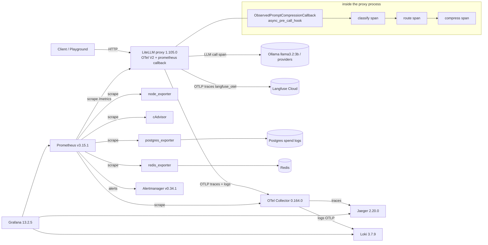

# Monitoring plan: prompt pipeline + LiteLLM gateway

Scope: `classifier -> router -> compressor -> LiteLLM -> provider` as it runs in the
docker-compose quickstart stack (`docker-compose.quickstart.yml`, LiteLLM 1.105.0 image,
Postgres 16, Redis 7, Rancher Desktop dockerd on Windows 11, CPU only, no GPU).

Versions this plan was checked against (installed, not docs):

| Component | Version | Where checked |
|---|---|---|
| LiteLLM proxy | 1.105.0 | `litellm-gateway-litellm-1`, `importlib.metadata` |
| OpenTelemetry API/SDK/OTLP exporters | 1.33.1 (semconv 0.54b1) | same container |
| prometheus_client | 0.20.0 | same container |
| langfuse SDK | 4.15.2 (not used: we use LiteLLM's `langfuse_otel`, which needs no SDK) | same container |
| OTel mode | `LITELLM_OTEL_V2=true` (compose default) | container env |
| Compressor | llmlingua 0.2.2, LLMLingua-2 `microsoft/llmlingua-2-bert-base-multilingual-cased-meetingbank` | unmodified |
| Classifier | `typeform/distilbert-base-uncased-mnli`, rules + router in `prompt_compression/` | observed only |

LiteLLM facts this plan relies on (file:line in the installed 1.105.0 package):

- `callbacks: ["prometheus"]` is not license-gated; it mounts `/metrics` on the proxy port and serves
  the default `prometheus_client.REGISTRY`, so our custom metrics appear there too
  (`integrations/prometheus.py:279,4574-4591`). Auth on `/metrics` is on by default
  (`litellm.require_auth_for_metrics_endpoint`, `__init__.py:191`).
- With `LITELLM_OTEL_V2`, one global TracerProvider is published at startup
  (`proxy/proxy_server.py:1435-1449`); its base exporter comes from `OTEL_EXPORTER` /
  `OTEL_EXPORTER_OTLP_ENDPOINT` (`integrations/otel/model/config.py:157-198`) and the
  `langfuse_otel` preset adds a second exporter to Langfuse on the same provider
  (`integrations/otel/presets/langfuse.py`). The FastAPI server span is the ambient span inside
  `async_pre_call_hook` (`integrations/otel/logger.py:836-843`), so child spans we open there land in
  the same trace as LiteLLM's auth / LLM-call / DB spans.
- No sampler code in LiteLLM: the SDK's `OTEL_TRACES_SAMPLER` / `OTEL_TRACES_SAMPLER_ARG` apply.
- `litellm_settings.turn_off_message_logging: true` scrubs messages from `model_call_details` and the
  standard logging payload before any success callback runs (`litellm_core_utils/redact_messages.py:268-377`),
  which covers `langfuse_otel`, `otel` and custom loggers. V2 also defaults
  `OTEL_INSTRUMENTATION_GENAI_CAPTURE_MESSAGE_CONTENT` to `no_content`, but compose currently sets it to
  `span_only`, i.e. **prompts reach Langfuse today**. This plan changes both.
- Spend logs never store prompts unless `store_prompts_in_spend_logs` is set (default off,
  `proxy/spend_tracking/spend_tracking_utils.py:1700-1716`); retention via
  `general_settings.maximum_spend_logs_retention_period`.
- `user_api_key_hash` in the logging payload is the stored token hash, never the raw key
  (`proxy/litellm_pre_call_utils.py:1615-1627`).

## 1. Signal inventory

Legend: **T** trace span/attribute, **M** metric, **L** log, **E** event. Privacy: **raw** = value as is
(no prompt content), **hashed**, **redacted**, **n/a** (numeric).

### Request

| Signal | Type | Source | Privacy |
|---|---|---|---|
| request ID (`litellm_call_id`) | T attr, L field | LiteLLM, our callback | raw (random id) |
| trace ID / span ID | T, L field | OTel V2 server span | raw |
| timestamp | T, L | OTel / logger | raw |
| model (requested model group), provider, endpoint/route | T, M label, L | LiteLLM V2 spans, `litellm_*` metrics, our log | raw |
| stream flag | T attr, L | our callback (`data["stream"]`) | raw |
| status / HTTP status code | T, M (`status_code` label), L | LiteLLM, our callback | raw |
| error class | T (exception event), L | LiteLLM failure hook, our callback | raw class name only; message redacted with rules |
| retries, fallback used | M (`litellm_deployment_successful_fallbacks`, `..._failed_fallbacks`), L | LiteLLM | raw |
| user / team / key ID | T attr (`user.id`), L | our callback | **hashed** (sha256 + `OBS_HASH_SALT`, 16 hex); key uses LiteLLM's existing hash |
| time to first token | M `litellm_llm_api_time_to_first_token_metric` | LiteLLM prometheus | n/a |
| total latency | M `litellm_request_total_latency_metric`, T span duration | LiteLLM | n/a |
| LiteLLM overhead / queue wait | M `litellm_overhead_latency_metric`; pipeline wait = `prompt_pipeline_duration_seconds` | LiteLLM, ours | n/a |

### Prompt pipeline (all from our observer; spans from `prompt_compression/pipeline.py`)

| Signal | Type | Privacy |
|---|---|---|
| classifier label per message, request category | T attr, M label (`label`), L | raw (enum) |
| top score, all label scores | T attr (`prompt.classifier.score`, `.scores.*`), M histogram `prompt_pipeline_classifier_top_score` | n/a |
| rule hits (rule **type** only) | T attr list, M `prompt_pipeline_rule_hits_total{rule}` | raw rule name, never matched text |
| decision source (rules / model / fallback_low_confidence / fallback_error / empty) | T attr, M label (`source`) | raw (enum) |
| cache hit | T attr, M `prompt_pipeline_classifier_cache_total{result}` | n/a |
| classifier latency | T span `prompt.classify`, M `prompt_pipeline_classifier_latency_seconds` | n/a |
| chunk count | T attr | n/a |
| routing decision (compress?, rate, redact) | T span `prompt.route`, M `route` label | raw (enum) |
| compressor latency | T span `prompt.compress`, M `prompt_pipeline_compress_latency_seconds` | n/a |
| prompt tokens before / after, ratio | T attr, M `prompt_pipeline_tokens_before_total`, `_after_total`, `_saved_total`, histogram `prompt_pipeline_compression_ratio` | n/a |
| redaction count | T attr, M `prompt_pipeline_redactions_total` | n/a |
| fail-open / fail-closed events, timeouts | E (span event + status), M `prompt_pipeline_failures_total{mode,reason}`, L warning | reason enum only |
| message text fingerprint | T attr `prompt.message.sha256`, `.chars`, `.tokens` | **hashed** |

### LLM usage

| Signal | Type | Source |
|---|---|---|
| input / output / cached tokens | M `litellm_input_tokens_metric`, `litellm_output_tokens_metric`, cached variants; T `gen_ai.usage.*` (Langfuse) | LiteLLM |
| cost USD per request / model / team | M `litellm_spend_metric`; Langfuse generation cost; Postgres `LiteLLM_SpendLogs.spend` | LiteLLM price map |
| budget used / remaining | M `litellm_remaining_{team,api_key,user}_budget_metric`, `*_max_budget_metric` | LiteLLM |
| rate-limit hits | M `litellm_proxy_failed_requests_metric{status_code="429"}`, `litellm_deployment_failure_responses` | LiteLLM |
| local pipeline compute cost (estimate) | M `prompt_pipeline_estimated_compute_cost_usd_total{component}`, T attr `prompt.cost.estimate_usd` | ours, `OBS_CPU_HOURLY_RATE_USD` |

### Infrastructure

| Signal | Type | Source |
|---|---|---|
| CPU, RAM, disk, network of the Docker VM | M `node_*` | node_exporter (in the Rancher Desktop WSL VM) |
| per-container CPU/RAM/network, restarts | M `container_*`, `container_start_time_seconds` (label `container_id`; Rancher Desktop gives no names) | cAdvisor (raw cgroup mode) |
| container health | M `up`, `container_*`; compose healthchecks | Prometheus, cAdvisor |
| Postgres health | M `pg_up`, `pg_stat_*` | postgres_exporter |
| Redis health | M `redis_up`, `redis_*` | redis_exporter |
| process uptime | M `process_start_time_seconds{job="litellm"}` | prometheus_client default collectors |
| model load time | M `prompt_pipeline_model_load_seconds{component}`, L | ours |
| error rate | M from `litellm_proxy_failed_requests_metric` / total | LiteLLM |
| GPU utilisation / memory | M `DCGM_FI_DEV_*` | DCGM exporter, compose profile `gpu` (no GPU here: config only) |
| Windows host metrics | M `windows_*` | windows_exporter on the host (not installed; see open questions) |

### Quality

| Signal | Type | Source |
|---|---|---|
| label distribution over time (drift) | M `prompt_pipeline_messages_total{label}` rate per label | ours |
| confidence distribution | M histogram `prompt_pipeline_classifier_top_score` | ours |
| periodic eval score | not exported as a metric; `prompt_compression/eval/benchmark.py` writes macro-F1 / sensitive recall to `eval/results/` when run (not scheduled; see open questions) | ours |
| user feedback | not collected by the app today; Langfuse scores API is the place if added | - |

### Logs

Every line from the `prompt_compression` and `observability` loggers is JSON with `timestamp`,
`level`, `logger`, `event`, `trace_id`, `span_id`, `request_id` plus event fields, written to stdout
and exported over OTLP to the collector -> Loki. Free-text values pass through `rules.redact()` first.

## 2. Tool mapping

| Signals | Tool | Why |
|---|---|---|
| Per-request LLM trace, generation tokens, cost, latency per generation, user (hashed) and session attribution, tags, scores | **Langfuse** (Cloud, via LiteLLM `langfuse_otel` on the V2 provider) | LLM-specific views: generations, cost, sessions, users, scores |
| Request spans across auth -> prompt pipeline (classify/route/compress) -> provider call -> DB | **OpenTelemetry SDK** (LiteLLM V2 provider) -> **OTel Collector** -> **Jaeger** | vendor-neutral span tree incl. infra spans (Postgres, Redis) that Langfuse is not built for |
| Request rate, latency histograms, tokens, spend, budgets, deployment health | **Prometheus** via LiteLLM built-in `prometheus` callback | built in; no custom code needed |
| Pipeline metrics (labels, ratio, tokens saved, classifier latency, failures) | **Prometheus** via `prometheus_client` in our callback (same `/metrics`) | low-cardinality time series and alerting |
| Dashboards | **Grafana**, provisioned from `monitoring/grafana/` | one place over Prometheus, Loki, Jaeger |
| Structured logs with trace_id | **Loki** fed by the **OTel Collector** (OTLP logs) | log search linked to traces (Grafana derived fields) |
| Host / container / DB / cache metrics | **node_exporter**, **cAdvisor**, **postgres_exporter**, **redis_exporter** | standard exporters |
| GPU | **NVIDIA DCGM exporter** (profile `gpu`, off) | no GPU on this machine |
| Alert routing | **Alertmanager** | Prometheus-native |
| Exception grouping | Sentry: **not added** (optional; LiteLLM has a `sentry` callback if wanted) | keeps scope; errors already in traces + logs |
| Spend history per key/team/user | **Postgres spend logs** (LiteLLM) | source of truth for billing; UI already reads it |

Where Langfuse is **not** the right tool: host/VM/container/GPU metrics, Postgres/Redis health, generic
application logs, alerting on thresholds. Where Prometheus is **not** the right tool: anything per
prompt or per request (traces, individual scores, per-user cost) - those would explode label
cardinality; they belong in Langfuse/Jaeger/spend logs.

## 3. Privacy and data handling (enforced in code)

| Rule | Enforcement |
|---|---|
| Sensitive prompts never raw in Langfuse/logs | `turn_off_message_logging: true` (global) + `OTEL_INSTRUMENTATION_GENAI_CAPTURE_MESSAGE_CONTENT=no_content`; our spans/logs carry only sha256, char length, token count, label. Tests assert no raw text in captured spans/logs. |
| Redact PII before export with the classifier's rule layer | `observability.privacy.scrub()` runs `prompt_compression.rules.redact()` over every free-text log/span value (error messages, reasons); collector `attributes/scrub` drops `gen_ai.prompt`/`gen_ai.completion`-style attributes as defence in depth |
| Pre/post-compression text only for non_sensitive and less_important, only if enabled | `OBS_CAPTURE_TEXT=false` (default). When `true`, the observer adds `prompt.text.before/after` span attributes for those two labels only, after `rules.redact()`; never for sensitive/critical |
| Hash user IDs and API keys, never export a raw key | `observability.privacy.hash_id()` = sha256(`OBS_HASH_SALT` + id)[:16] for user/team/end-user ids; keys only as LiteLLM's existing `user_api_key_hash`; Prometheus built-ins drop `user`, `user_email`, `end_user`, `client_ip`, `user_agent`, `api_key_alias` via `prometheus_exclude_labels` |
| Prompts in spend logs | stay off (`store_prompts_in_spend_logs` default false) |

Retention:

| Store | Retention | Where set |
|---|---|---|
| Langfuse Cloud | plan default (Hobby: 30 days of data access); set explicitly in project settings -> Data retention | Langfuse UI (cannot be set from code here) |
| Prometheus | 15 days | `--storage.tsdb.retention.time=15d` |
| Loki | 7 days | `limits_config.retention_period: 168h` |
| Jaeger | in-memory, last 50,000 traces, lost on restart (dev) | `--set extensions.jaeger_storage.backends.memstore.memory.max_traces=50000` |
| Postgres spend logs | 30 days | `general_settings.maximum_spend_logs_retention_period: 30d` |
| Alertmanager | 120 h (default) | `--data.retention=120h` |

## 4. Cost model

- Provider cost: LiteLLM's model price map computes `response_cost` per request; it flows to
  `litellm_spend_metric`, Postgres spend logs and Langfuse (`gen_ai.cost.*`). The local Ollama model
  (`llama3.2:3b`) is priced at 0 by LiteLLM, so cost is exactly 0 there; a config-only model
  `obs-priced-llama` with explicit **test** prices exercises non-zero cost end to end.
- Local classifier/compressor: wall time of `prompt.classify` and `prompt.compress` x
  `OBS_CPU_HOURLY_RATE_USD` (default 0.10 USD/h for this 4-core laptop CPU; `OBS_GPU_HOURLY_RATE_USD`
  default 0, used only if `OBS_COMPUTE_DEVICE=gpu`). Exported as
  `prompt_pipeline_estimated_compute_cost_usd_total{component}` and span attr
  `prompt.cost.estimate_usd`; always labelled **estimate**.

## 5. Architecture

## 6. Rollout order (each step verified before the next)

1. **Request metrics + traces**: enable `prometheus`, `otel` (V2, collector exporter) and keep
   `langfuse_otel`; turn off message logging. Verify: `curl /metrics` shows `litellm_*`; Jaeger shows a
   trace for one request; Langfuse API returns the trace with no message text.
2. **Pipeline metrics/spans/logs**: switch the callback to `ObservedPromptCompressionCallback`.
   Verify: pytest suite; Jaeger trace has `prompt.pipeline > prompt.classify/route/compress`;
   `prompt_pipeline_*` series in Prometheus; Loki query by `trace_id` returns the JSON log lines.
3. **Infrastructure**: exporters + cAdvisor. Verify: `up{}` = 1 for every job in Prometheus targets.
4. **Alerts + dashboards**: load rules, provision Grafana. Verify: rules healthy in `/api/v1/rules`;
   one alert forced to fire with a temporary low threshold; dashboards return data.

## 7. Open questions and defaults chosen

| Question | Default chosen |
|---|---|
| Langfuse Cloud vs self-hosted | Cloud (already configured in `.env`); retention must be set in its UI |
| Jaeger vs Tempo | Jaeger 2 (single container, built-in UI); memory store, dev only |
| Trace sampling | 100% (`OTEL_TRACES_SAMPLER=parentbased_traceidratio`, `OTEL_TRACES_SAMPLER_ARG=1.0`); lower in production |
| Windows host metrics | node_exporter measures the Rancher Desktop VM that runs the containers; windows_exporter (host service) left as a documented optional step, not installed |
| GPU | DCGM exporter defined under compose profile `gpu`, never started here |
| `/metrics` auth | disabled (`require_auth_for_metrics_endpoint: false`); proxy port is bound to 127.0.0.1 by `LITELLM_BIND` |
| Prometheus identity labels | drop user/email/end_user/ip/user_agent/key alias; keep `hashed_api_key` and `team` for budget gauges |
| CPU hourly rate | 0.10 USD/h (laptop estimate) |
| Storing text for non_sensitive/less_important | off (`OBS_CAPTURE_TEXT=false`) |
| Sentry | not added |
| Periodic eval | not scheduled and not exported; add a Pushgateway or a Langfuse score if you want it on a dashboard |
| Multi-worker proxy | single worker assumed; with `--num_workers > 1` set `PROMETHEUS_MULTIPROC_DIR` and our metrics switch to multiprocess mode (documented, untested) |

## 8. Verification results (2026-11-04)

Evidence: `monitoring/results/verification.txt`, `monitoring/results/overhead_*.json`.

| Check | Result |
|---|---|
| Trace per request in Jaeger with `prompt.pipeline > prompt.classify / prompt.route / prompt.compress`, plus LiteLLM `auth`, `chat <model>`, Postgres and Redis spans | yes, all 4 categories + streaming |
| Same trace in Langfuse | yes (generation span; tags, hashed user, session); pipeline spans only in Jaeger |
| Langfuse usage and cost = proxy usage and `x-litellm-response-cost` | equal for all 4 categories |
| Raw prompt text in Langfuse input/output, container logs, Loki, span attributes | none found |
| Loki lines with the request's trace_id | 4 per request (pipeline, provider result, two plain pipeline lines) |
| Prometheus series for every pipeline, LiteLLM and infra metric | yes; all targets up except `dcgm` (no GPU) |
| Grafana dashboards provisioned from files, panels with data | 3 dashboards; panels without data are budgets/fallbacks/failures that did not occur |
| Deliberate alert | `GatewayHighP95LatencyTEST` (1 ms threshold) fired in Prometheus and reached Alertmanager; rule removed afterwards |
| Monitoring overhead (uncompressed requests, n=150 each) | p50 +4.6 ms, mean +5.4 ms, p95 +0.6 ms |

Changes made during verification: Jaeger pinned to 2.20.0 (Grafana compatibility), cAdvisor in raw cgroup
mode, monitoring compose run with `-p litellm-monitoring` (COMPOSE_PROJECT_NAME in `.env`).
